<p align="center">
  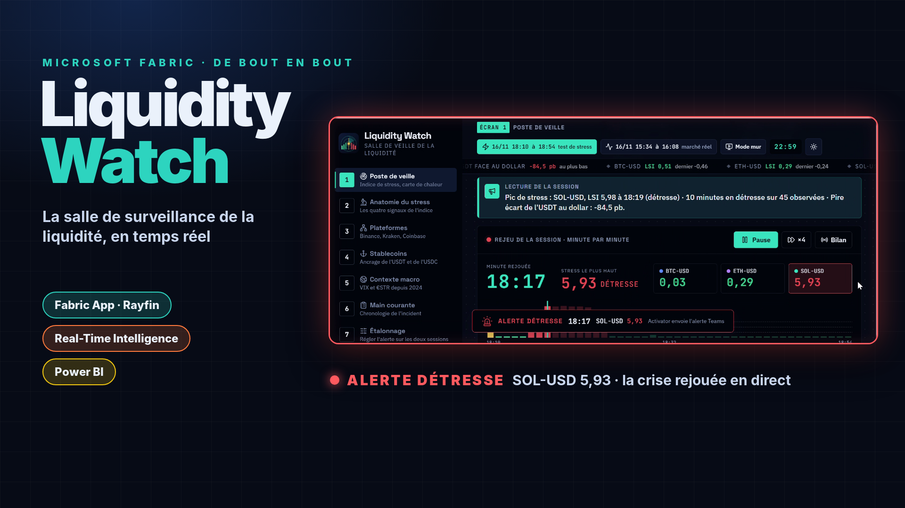
</p>

<h1 align="center">📡 Liquidity Watch · Salle de surveillance de la liquidité sur Microsoft Fabric</h1>

<p align="center">
  <b>Des carnets d'ordres publics jusqu'à l'alerte Teams, en temps réel, puis au rapport Power BI et à la salle de veille Fabric Apps.</b><br>
  Real-Time Intelligence · Eventstream · Eventhouse · KQL · OneLake · Activator · Power BI · Fabric Apps.<br>
  Trois plateformes, cinq marchés, une photo des carnets toutes les cinq secondes. Un guide public pour tout reconstruire.
</p>

<p align="center">
  
  
  
  
  
  
  
  
  
  
</p>

<p align="center">
  <a href="docs/LiquidityWatch_Guide_Public.pdf"><b>📘 Guide pas à pas (PDF)</b></a> ·
  <a href="docs/RPT_LiquidityWatch.pdf"><b>📊 Rapport Power BI (PDF)</b></a> ·
  <a href="powerbi/"><b>🧠 Modèle sémantique</b></a> ·
  <a href="application/"><b>📱 Salle de veille Fabric Apps</b></a> ·
  <a href="https://www.linkedin.com/in/abdoul-hamid-diallo-fabric-data-engineer/"><b>💼 LinkedIn</b></a>
</p>

<p align="center">
  Réalisé par <b>Abdoul Hamid Diallo</b>, Microsoft Fabric Data Engineer, titulaire de <b>7 certifications Microsoft</b><br>
        
</p>

---

## 🎬 Aperçu

<p align="center">
  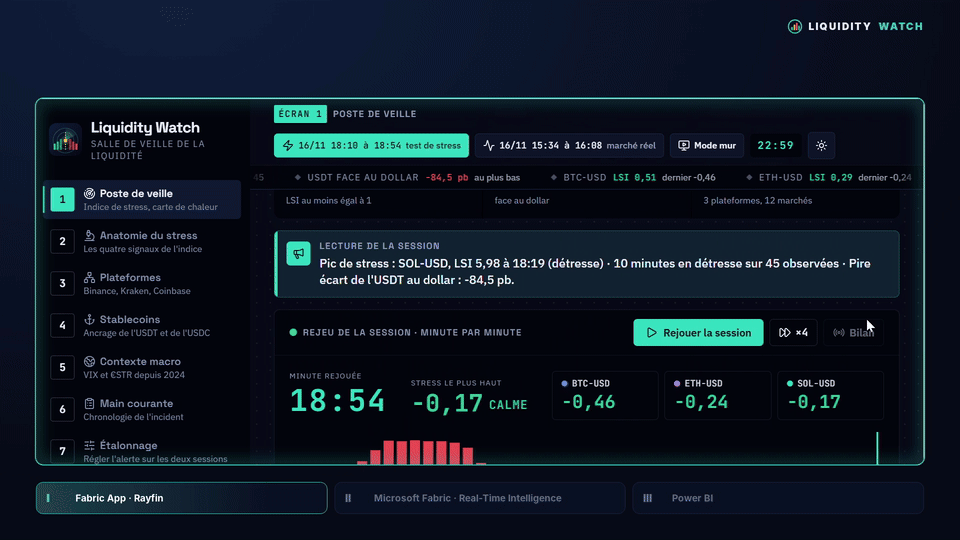
</p>

<p align="center"><i>La crise du test de stress rejouée minute par minute : dès que SOL-USD franchit le seuil de détresse, toute la salle passe en alarme.</i></p>

| | |
|---|---|
| 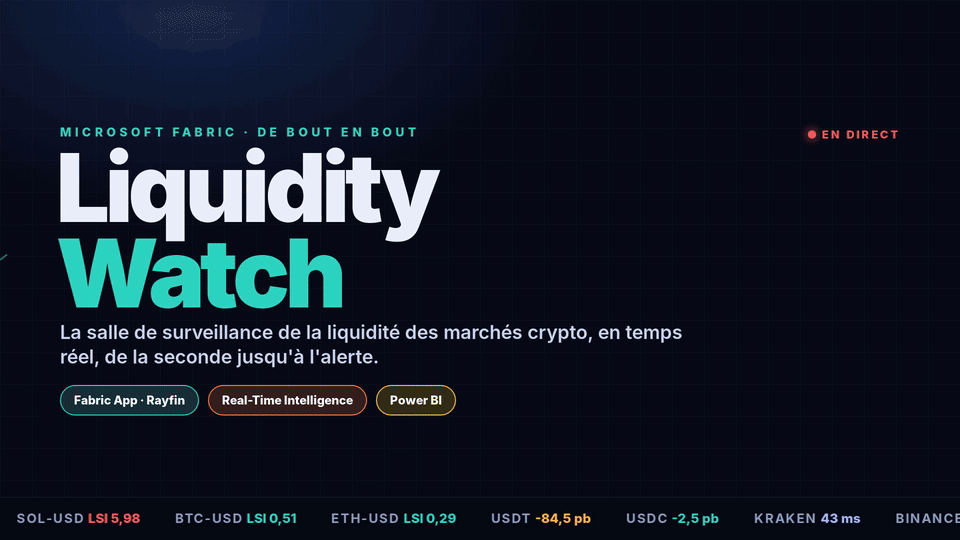 | 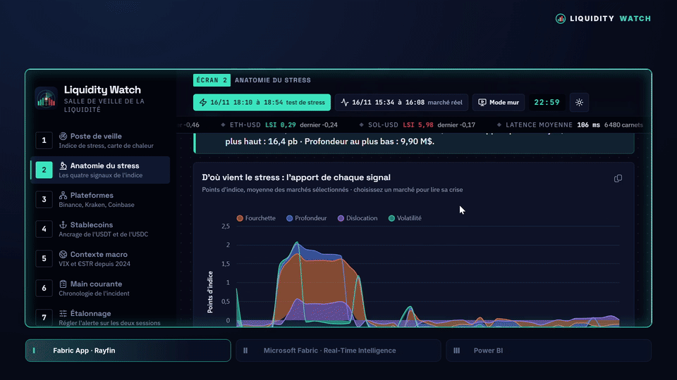 |
| **L'étalonnage de l'alerte** | **L'architecture** |
| 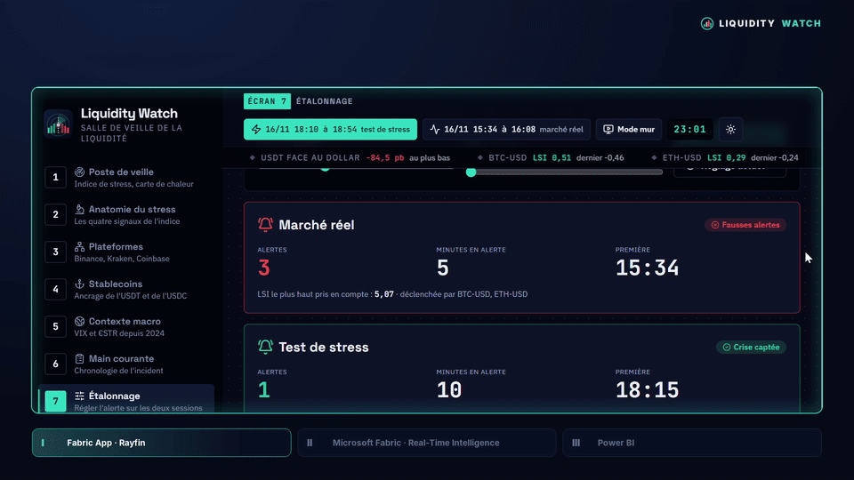 | 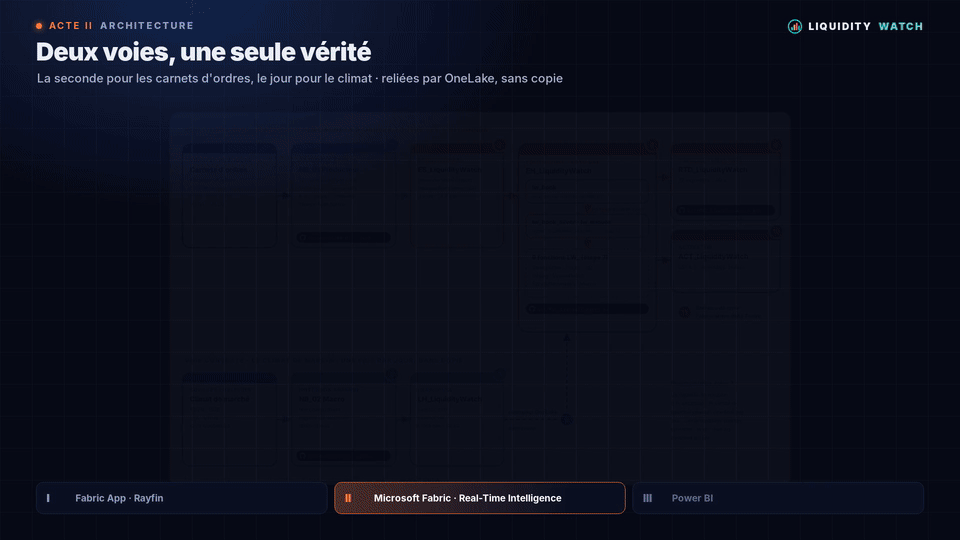 |

---

## 🏗️ Architecture

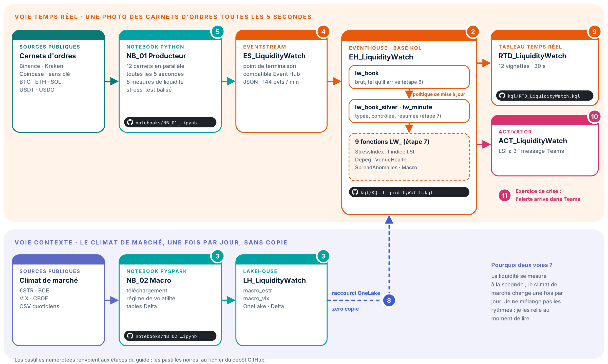

**Liquidity Watch** est la salle de surveillance d'un desk de trading. Toutes les **5 secondes**, un producteur Python photographie les carnets d'ordres publics de **trois plateformes** (Binance, Kraken, Coinbase) sur **cinq marchés** (BTC, ETH, SOL, USDT, USDC). Il mesure ce qu'il en coûte de traiter (la fourchette), combien on peut traiter (la profondeur), si les plateformes divergent (la dislocation) et si les stablecoins tiennent leur dollar. Tout est condensé en un **indice de stress de liquidité (LSI)**.

Deux voies cohabitent et se rejoignent dans OneLake :

- **La voie temps réel** raconte la seconde. Eventstream reçoit le flux sur un point de terminaison compatible Event Hub, l'Eventhouse le type et le résume en KQL, un tableau de bord temps réel le montre toutes les 30 secondes, et **Activator** envoie une alerte **Microsoft Teams** dès qu'un marché passe en détresse.
- **La voie contexte** raconte le climat. Un notebook PySpark charge chaque jour le **VIX** (CBOE) et l'**€STR** (BCE) dans un lakehouse ; l'Eventhouse les lit au travers d'un **raccourci OneLake**, sans copie.

Toutes les sources sont **publiques, gratuites et sans clé d'API**.

---

## 🎯 Résultats clés

Chiffres de la séance de test de stress du 16/11/2026, de 18:10 à 18:54 (heure de Paris), lus dans le modèle sémantique.

| Domaine | Indicateur | Valeur |
|---|---|---|
| 📥 Flux | Carnets d'ordres analysés | **6 480** |
| | Carnets par minute | **144** (12 flux toutes les 5 secondes) |
| | Plateformes · marchés | **3 · 5** |
| 🚨 Stress | Pic de l'indice (LSI) | **5,98** sur SOL-USD à 18:19, niveau Détresse |
| | Minutes en détresse | **10** sur 45 observées, de 18:15 à 18:24 |
| | Marchés touchés | **1** seul : BTC (0,51) et ETH (0,29) restent calmes |
| 🪙 Stablecoins | Pire écart de l'USDT au dollar | **-84,5 pb**, soit 8 minutes en décrochage |
| | USDC | **-2,5 pb**, ancré tout au long de la crise |
| 🌐 Plateformes | Temps de réponse moyen | Kraken **43 ms** · Coinbase **83 ms** · Binance **242 ms** |
| | Écartements anormaux de fourchette | **20**, dont 46,25 pb chez Binance sur SOL pour 1,40 pb d'habitude |
| 🌍 Contexte | VIX, dernière clôture | **19,30**, régime Normal (maximum depuis 2024 : 52,33 le 08/04/2025) |
| | €STR | **2,437 %** |
| 🎯 Étalonnage | Réglage de l'alerte retenu | seuil **3** avec **5 minutes de chauffe** : zéro fausse alerte sur la séance de marché réel, crise captée dès 18:15 |

---

## 💼 Impact métier

- **Voir la crise à la seconde, pas le lendemain.** Le desk sait quel marché se tend, sur quelle plateforme et pourquoi (fourchette, profondeur, dislocation ou volatilité), pendant que ça se passe.
- **Isoler le foyer.** L'indice compare chaque marché à lui-même : la crise de SOL ne contamine ni BTC ni ETH, et l'équipe ne réduit pas ses positions partout par réflexe.
- **Surveiller le premier domino.** Un stablecoin qui décroche annonce souvent une crise de liquidité : la salle suit l'USDT et l'USDC au point de base près.
- **Agir sans regarder l'écran.** Activator envoie l'alerte dans Microsoft Teams ; personne n'a besoin de rester devant le tableau de bord.
- **Une alerte qui mérite d'être écoutée.** Le banc d'étalonnage rejoue une vraie séance de marché et la crise simulée : le réglage retenu sonne pendant la crise et se tait un jour ordinaire.

---

## 🧭 Synthèse

| Question | Réponse apportée par la plateforme |
|---|---|
| Le marché est-il liquide en ce moment ? | L'indice de chaque marché, minute par minute, avec quatre niveaux : Calme, Tendu, Stress, Détresse. |
| D'où vient le stress ? | L'apport de chaque signal : fourchette (35 %), profondeur (35 %), dislocation (15 %), volatilité (15 %). |
| Quelle plateforme décroche ? | Fourchette, profondeur et temps de réponse de Binance, Kraken et Coinbase, et la liste des écartements anormaux. |
| Les stablecoins tiennent-ils leur dollar ? | L'écart de l'USDT et de l'USDC, avec les seuils de surveillance (-20 pb) et de décrochage (-50 pb). |
| Le stress est-il local ou global ? | Le VIX et l'€STR, lus dans le lakehouse, à côté de l'indice. |
| Que s'est-il passé, minute par minute ? | La main courante horodatée de l'incident et le rejeu de la séance dans la salle de veille. |

---

## 📈 L'indice de stress de liquidité

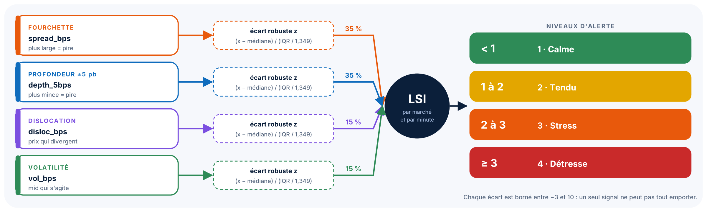

Chaque minute, quatre signaux sont comparés **au niveau habituel du marché**, mesuré par la médiane et l'écart interquartile des 90 dernières minutes. Ces statistiques robustes ne se laissent pas emporter par l'épisode de stress qu'on cherche justement à détecter. Chaque écart est borné entre -3 et 10 : un signal isolé ne suffit pas à déclencher l'alerte.

```kql
| extend z_spread = (spread_bps - s50) / max_of((s75 - s25) / 1.349, s50 * 0.05, 0.01),
         z_depth  = (d50 - depth_5bps) / max_of((d75 - d25) / 1.349, d50 * 0.05, 1.0),
         z_disloc = (disloc_bps - x50) / max_of((x75 - x25) / 1.349, 0.5),
         z_vol    = (vol_bps - v50) / max_of((v75 - v25) / 1.349, 0.5)
| extend lsi = round(0.35 * min_of(max_of(z_spread, -3.0), 10.0) + 0.35 * min_of(max_of(z_depth, -3.0), 10.0)
                   + 0.15 * min_of(max_of(z_disloc, -3.0), 10.0) + 0.15 * min_of(max_of(z_vol, -3.0), 10.0), 2)
| extend niveau = case(lsi >= 3, "4 · Détresse", lsi >= 2, "3 · Stress", lsi >= 1, "2 · Tendu", "1 · Calme")
```

---

## 🧬 Lignage

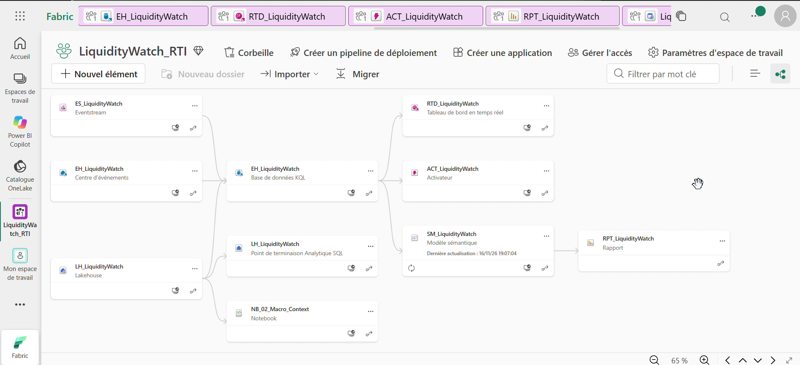

| Couche | Élément Fabric | Ce qui s'y passe |
|---|---|---|
| Source | `NB_01_Liquidity_Producer` | 12 carnets lus en parallèle toutes les 5 secondes, 8 mesures de liquidité, stress-test balisé `STRESS_TEST` |
| Ingestion | `ES_LiquidityWatch` | point de terminaison personnalisé compatible Event Hub, destination `dst_eventhouse` |
| 🥉 Brut | `lw_book` | chaque carnet tel qu'il arrive, 7 jours de rétention |
| 🥈 Typé | `lw_book_silver` · `lw_minute` | politique de mise à jour, contrôle des types, vue matérialisée par minute |
| 🧠 Signaux | 9 fonctions `LW_` | horloge, fenêtre glissante, mesures consolidées, indice, ancrage, santé des flux, anomalies, contexte macro |
| 🌍 Contexte | `NB_02_Macro_Context` · `LH_LiquidityWatch` | VIX et €STR en tables Delta, lus par raccourci OneLake |
| ⚡ Restitution | `RTD_LiquidityWatch` · `ACT_LiquidityWatch` | 12 vignettes rafraîchies toutes les 30 s, alerte Teams |
| 📊 Analyse | `SM_LiquidityWatch` · `RPT_LiquidityWatch` | modèle sémantique et rapport Power BI de 5 pages |
| 📱 Salle de veille | `LiquidityWatch_SalleDeVeille` | Fabric App Rayfin de 7 écrans |

| Eventhouse | Table `lw_book` |
|---|---|
| 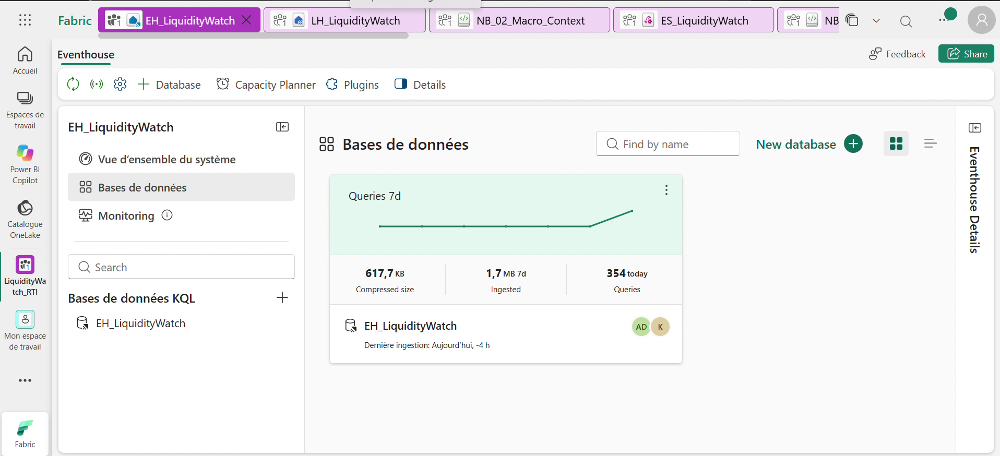 | 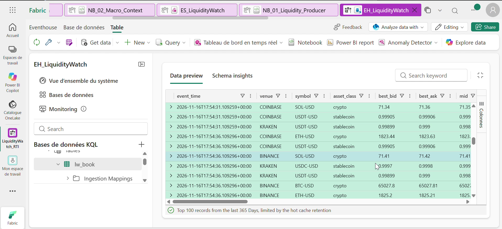 |
| **Eventstream** | **Producteur NB_01 en marche** |
| 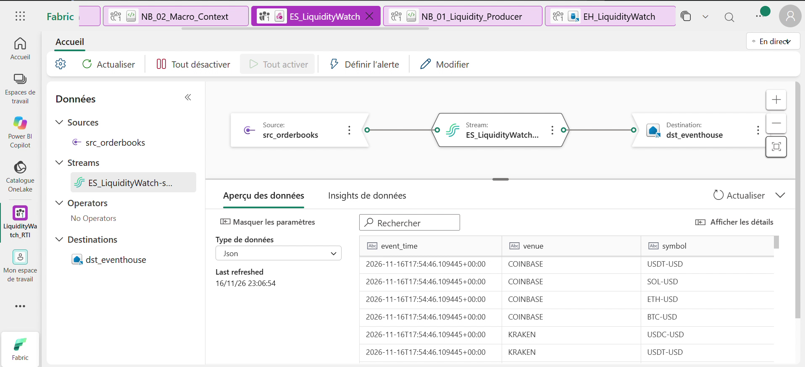 | 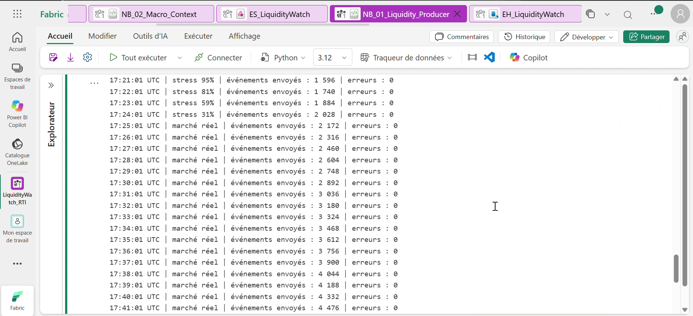 |

---

## ⚡ Temps réel

| Élément | Rôle |
|---|---|
| [`NB_01_Liquidity_Producer`](notebooks/NB_01_Liquidity_Producer.ipynb) | lit les carnets publics, calcule fourchette, profondeur à ±5 et ±20 pb, déséquilibre, microprix, couverture, latence, et envoie un JSON par carnet |
| `ES_LiquidityWatch` | reçoit le flux et le pousse dans l'Eventhouse |
| [`KQL_LiquidityWatch.kql`](kql/KQL_LiquidityWatch.kql) | 10 blocs : table typée, politique de mise à jour, rétention, vue matérialisée, fonctions de l'indice et des signaux |
| [`RTD_LiquidityWatch.kql`](kql/RTD_LiquidityWatch.kql) | les 12 requêtes du tableau de bord, chacune une seule fonction |
| `ACT_LiquidityWatch` | alerte Microsoft Teams quand le LSI d'un marché atteint 3 |

```kql
// L'état de chaque marché à la dernière minute connue
LW_StressIndex(90)
| summarize arg_max(minute, *) by symbol
| project symbol, minute, lsi, niveau, spread_bps, depth_5bps, disloc_bps
```

### 📺 Le tableau de bord en temps réel `RTD_LiquidityWatch`

Les 12 requêtes KQL alimentent un tableau de bord Real-Time Intelligence qui se rafraîchit tout seul : l'indice de stress par marché, la fourchette, la profondeur, la dislocation entre plateformes, l'ancrage des stablecoins, la santé des flux et le contexte macro, sur la dernière heure.

<p align="center">
  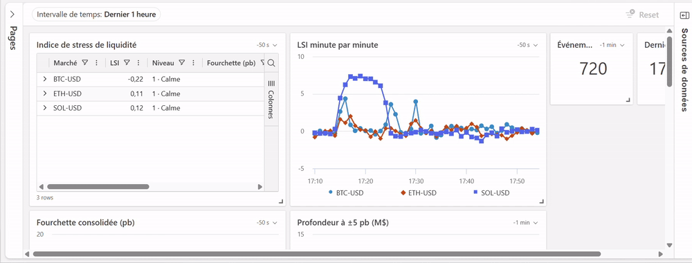
</p>

| | |
|---|---|
| 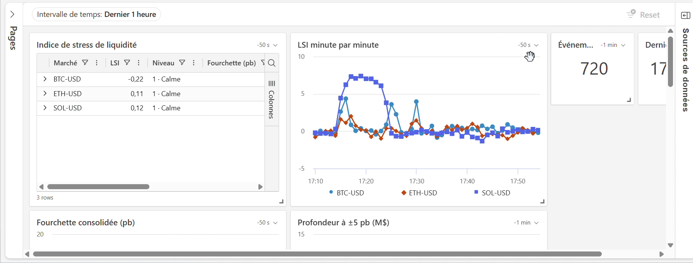 | 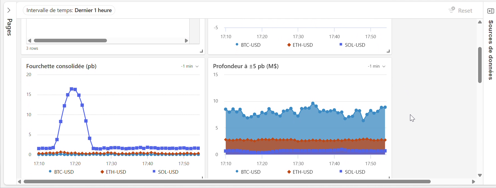 |
| **Indice de stress** : le niveau de chaque marché, le LSI minute par minute, 720 événements dans l'heure | **Fourchette et profondeur** : le pic de fourchette de SOL-USD face à une profondeur stable |
| 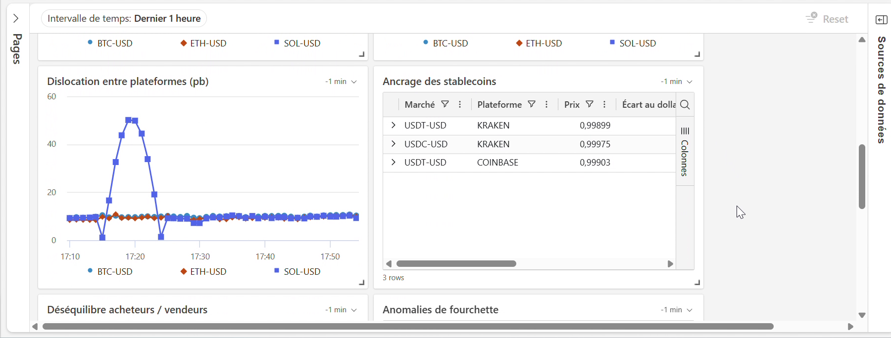 | 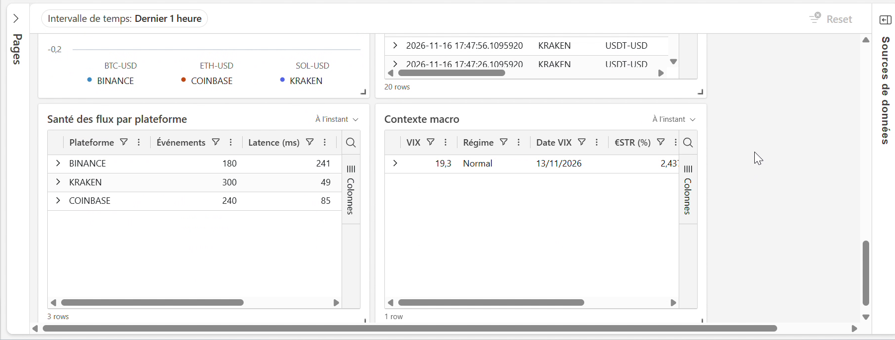 |
| **Dislocation et ancrage** : l'écart entre plateformes et le prix de l'USDT et de l'USDC | **Santé des flux et contexte macro** : événements et latence par plateforme, VIX et €STR |

---

## 📊 Rapport Power BI

| Synthèse | Anatomie du stress |
|---|---|
| 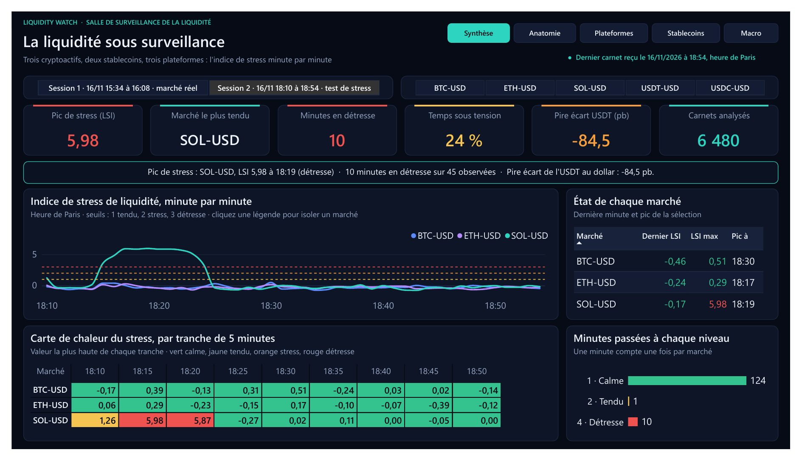 | 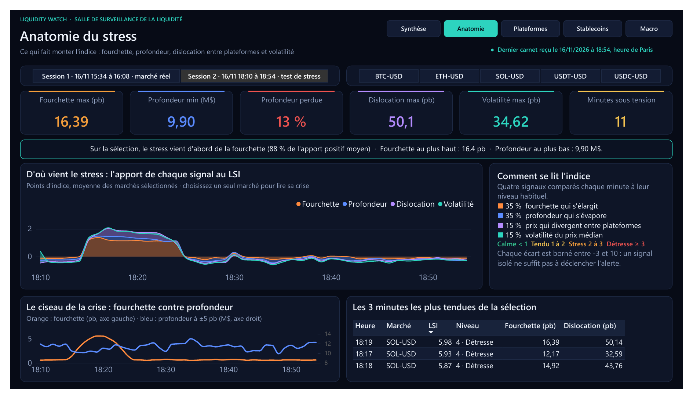 |
| **Plateformes** | **Stablecoins** |
| 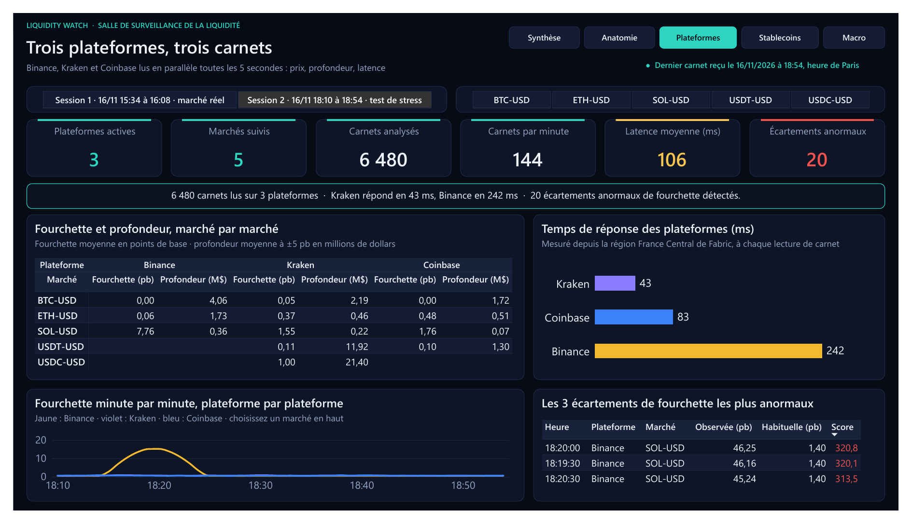 | 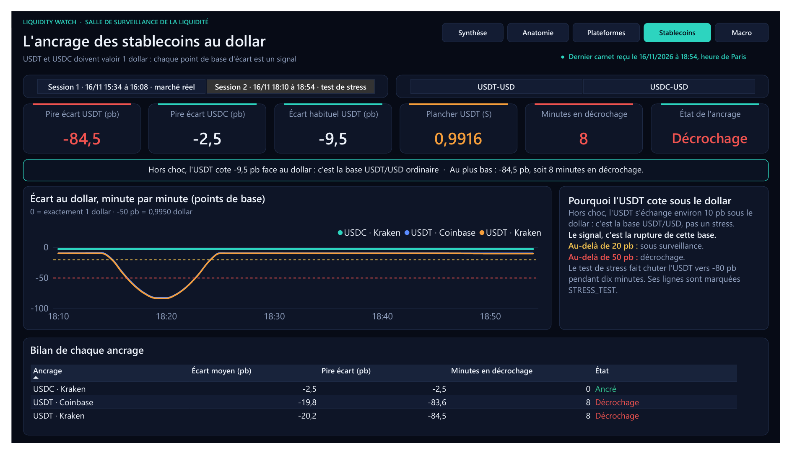 |
| **Contexte macro** | |
| 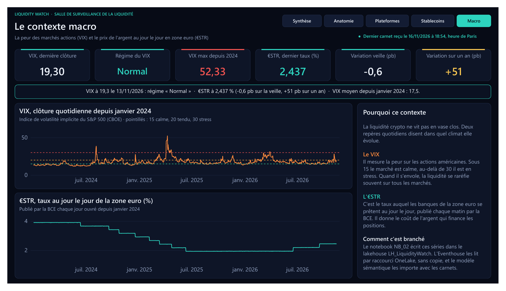 | |

👉 Le rapport complet : [`docs/RPT_LiquidityWatch.pdf`](docs/RPT_LiquidityWatch.pdf)

<p align="center">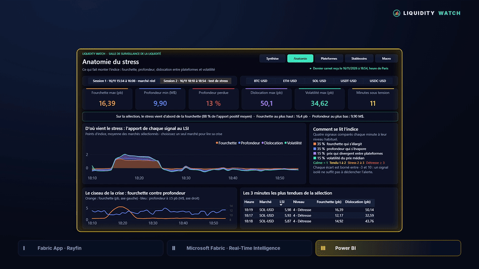</p>

---

## 🧠 Modèle sémantique

`SM_LiquidityWatch` importe les tables de l'Eventhouse par des requêtes KQL (connecteur Azure Data Explorer) et les organise en étoile :

| Rôle | Tables |
|---|---|
| Dimensions | `Temps` (minute, session, fenêtre de choc, tranche de 5 minutes) · `Marché` · `Plateforme` |
| Faits | `LSI` (indice et quatre écarts par minute) · `Carnets` (fourchette, profondeur, latence) · `Anomalies` |
| Contexte | `VIX` · `Taux €STR`, séries quotidiennes depuis janvier 2024 |
| Mesures | `Mesures`, **74 mesures DAX** en six dossiers : Stress, Liquidité, Plateformes, Stablecoins, Contexte macro, Textes et couleurs |

Les récits du rapport (« Pic de stress : SOL-USD, LSI 5,98 à 18:19… ») et les couleurs de niveau sont calculés en DAX, et se mettent à jour avec la sélection de session et de marché.

```dax
Heure du pic =
    VAR mx = [LSI maximal]
    VAR h = MINX ( FILTER ( 'LSI', 'LSI'[LSI] = mx ), RELATED ( 'Temps'[Heure] ) )
    RETURN IF ( NOT ISBLANK ( h ), FORMAT ( h, "hh:nn" ) )
```

Définition complète au format **TMDL**, rapport au format **PBIR** : [`powerbi/`](powerbi/).

---

## 📱 La salle de veille Fabric Apps

| 1 · Poste de veille | Jauges des marchés |
|---|---|
| 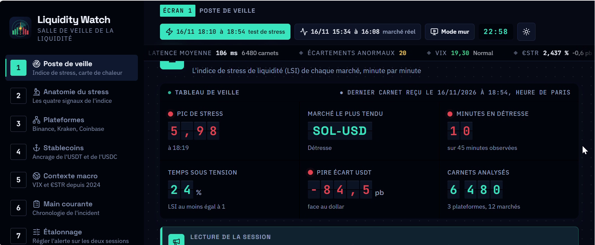 | 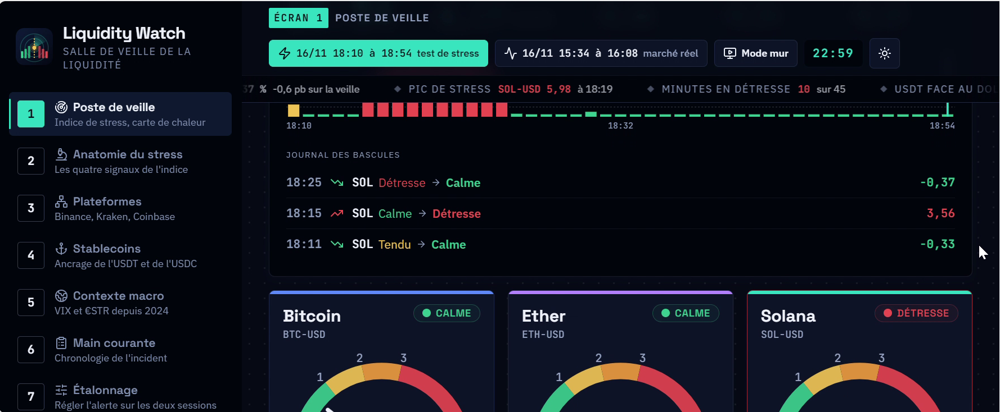 |
| **Rejeu de la crise et alarme** | **2 · Anatomie du stress (thème jour)** |
| 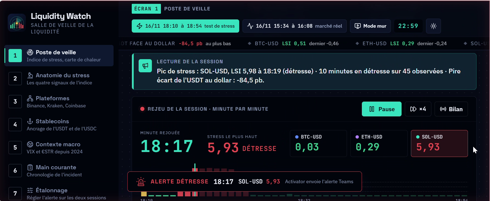 | 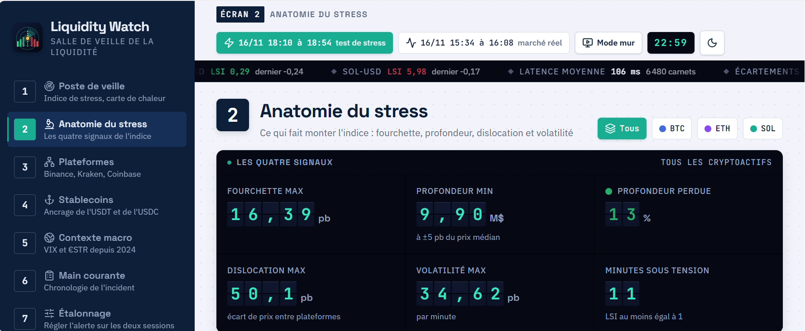 |

<details>
<summary><b>🖼️ Voir les autres écrans</b></summary>

| | |
|---|---|
| **3 · Plateformes** | **4 · Stablecoins** |
| 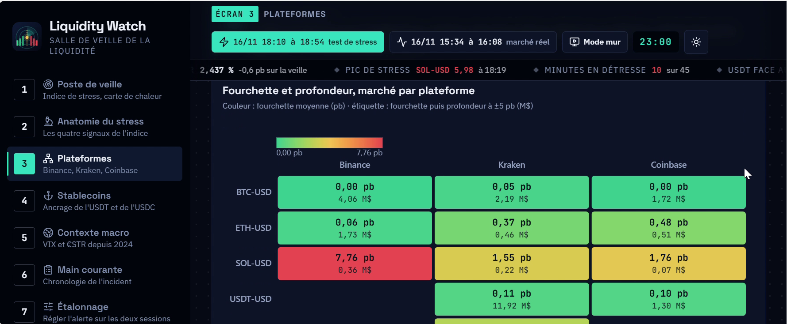 | 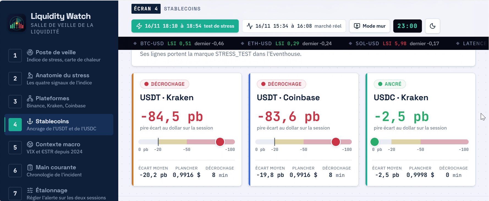 |
| **5 · Contexte macro** | **6 · Main courante de l'incident** |
| 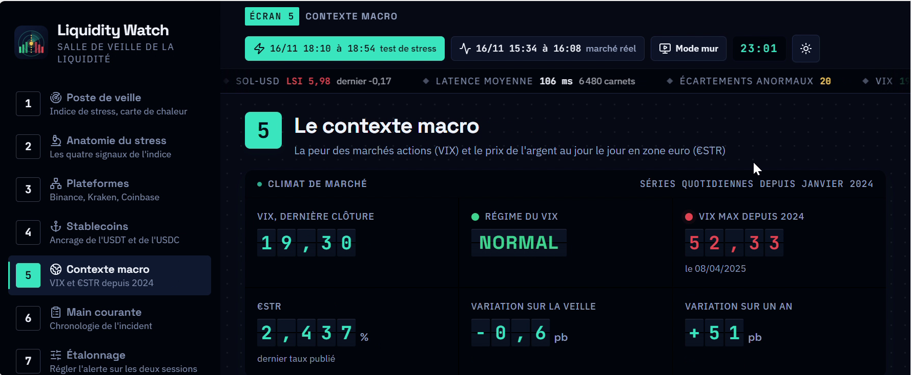 | 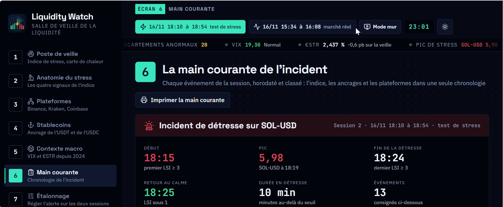 |
| **7 · Étalonnage de l'alerte** | |
| 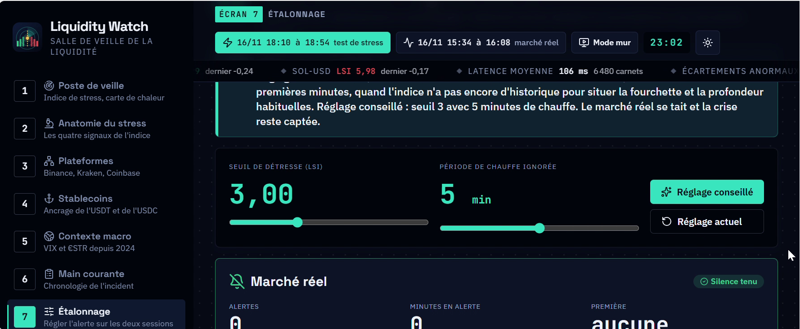 | |

</details>

**Liquidity Watch · Salle de veille** est une application React hébergée **dans** l'espace de travail Fabric (Fabric Apps, moteur Rayfin). Elle interroge `SM_LiquidityWatch` en DAX, en direct, avec les droits de l'utilisateur connecté :

- **7 écrans** : Poste de veille, Anatomie du stress, Plateformes, Stablecoins, Contexte macro, Main courante, Étalonnage ;
- **rejeu de la séance** minute par minute (×1, ×4, ×10), avec jauges animées, journal des bascules et alarme de détresse ;
- **téléscripteur** des chiffres clés et **mode mur** qui fait défiler les écrans en plein écran ;
- **main courante** imprimable et **banc d'étalonnage** de l'alerte ;
- thème nuit et thème jour, raccourcis clavier, 110 tests unitaires.

Code source et déploiement : [`application/`](application/).

---

## 📘 Le guide pas à pas

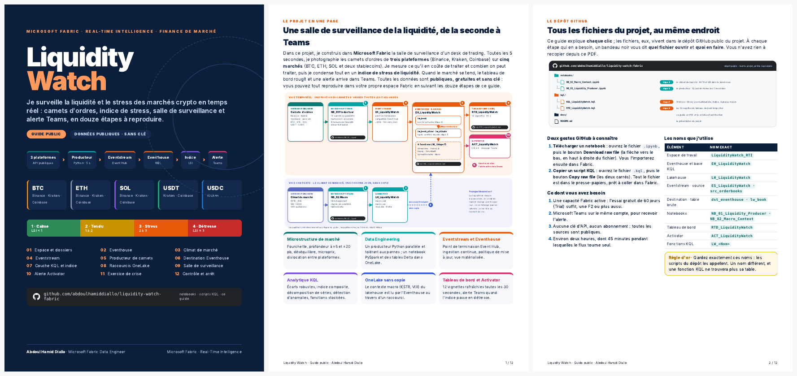

[`LiquidityWatch_Guide_Public.pdf`](docs/LiquidityWatch_Guide_Public.pdf) reconstruit toute la partie Microsoft Fabric, **de l'espace de travail jusqu'à l'alerte Teams**, en **12 étapes**. Chaque étape donne quoi cliquer, les noms exacts à saisir, un point de contrôle et un encadré *Pourquoi je l'ai fait ainsi*. Un tableau *Si ça bloque* traite les situations qu'on rencontre réellement.

| | Étapes |
|---|---|
| Fondations | 1 Espace et dossiers · 2 Eventhouse · 3 Climat de marché |
| Le flux | 4 Eventstream · 5 Producteur de carnets · 6 Destination Eventhouse |
| L'intelligence | 7 Couche KQL et indice · 8 Raccourcis OneLake · 9 Salle de surveillance |
| L'action | 10 Alerte Activator · 11 Exercice de crise · 12 Contrôle et arrêt |

---

## 🗂️ Organisation du dépôt

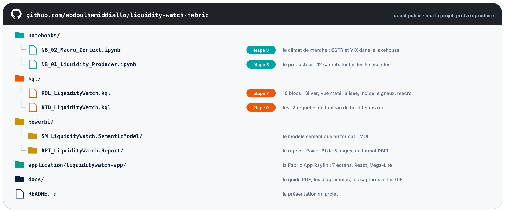

```text
liquidity-watch-fabric/
├── README.md
├── notebooks/
│   ├── NB_01_Liquidity_Producer.ipynb      producteur de carnets d'ordres (étape 5)
│   └── NB_02_Macro_Context.ipynb           VIX et €STR dans le lakehouse (étape 3)
├── kql/
│   ├── KQL_LiquidityWatch.kql              10 blocs : tables, politiques, vue, fonctions (étapes 7 et 8)
│   └── RTD_LiquidityWatch.kql              12 requêtes du tableau de bord (étape 9)
├── powerbi/
│   ├── LiquidityWatch.pbip                 projet Power BI à ouvrir dans Power BI Desktop
│   ├── SM_LiquidityWatch.SemanticModel/    modèle sémantique (TMDL)
│   └── RPT_LiquidityWatch.Report/          rapport de 5 pages (PBIR)
├── application/
│   └── liquiditywatch-app/                 salle de veille Fabric Apps (React, Vega-Lite)
└── docs/
    ├── LiquidityWatch_Guide_Public.pdf     guide pas à pas, 12 étapes
    ├── RPT_LiquidityWatch.pdf              rapport Power BI, 5 pages
    ├── diagrammes/                         architecture, indice, organisation du dépôt (SVG et PNG)
    ├── gifs/                               aperçus animés
    └── images/                             application, rapport, captures Fabric, guide
```

Chaque dossier a son propre README.

---

## 🚀 Reproduire le projet

1. Activez une capacité Fabric (l'essai gratuit suffit) et ouvrez le [guide](docs/LiquidityWatch_Guide_Public.pdf).
2. Créez l'espace `LiquidityWatch_RTI` et l'Eventhouse `EH_LiquidityWatch` (étapes 1 et 2).
3. Importez [`NB_02_Macro_Context`](notebooks/NB_02_Macro_Context.ipynb) et chargez le climat de marché (étape 3).
4. Créez l'Eventstream, collez sa chaîne de connexion dans [`NB_01_Liquidity_Producer`](notebooks/NB_01_Liquidity_Producer.ipynb) et lancez le flux (étapes 4 à 6).
5. Exécutez [`KQL_LiquidityWatch.kql`](kql/KQL_LiquidityWatch.kql) bloc par bloc, puis créez les raccourcis OneLake (étapes 7 et 8).
6. Montez le tableau de bord avec [`RTD_LiquidityWatch.kql`](kql/RTD_LiquidityWatch.kql), l'alerte Activator, puis rejouez la crise avec `STRESS_TEST = True` (étapes 9 à 11).
7. Pour l'analyse : ouvrez [`powerbi/LiquidityWatch.pbip`](powerbi/), renseignez le paramètre `Cluster` avec l'adresse de votre Eventhouse et publiez. Pour la salle de veille : suivez [`application/`](application/).

> La chaîne de connexion de l'Eventstream est un mot de passe : le notebook du dépôt contient un emplacement vide à sa place, ne la publiez jamais.

---

## 🧰 Stack technique

| Charge de travail | Éléments | Technologies |
|---|---|---|
| Data Engineering | `NB_01_Liquidity_Producer`, `NB_02_Macro_Context`, `LH_LiquidityWatch` | Python, requêtes parallèles, `azure-eventhub`, PySpark, Delta Lake |
| Real-Time Intelligence | `ES_LiquidityWatch`, `EH_LiquidityWatch`, `RTD_LiquidityWatch` | Eventstream (Event Hub), KQL, politique de mise à jour, vue matérialisée, `series_decompose_anomalies` |
| OneLake | raccourcis `macro_estr`, `macro_vix` | zéro copie entre lakehouse et Eventhouse |
| Activator | `ACT_LiquidityWatch` | règle sur le LSI, message Microsoft Teams |
| Power BI | `SM_LiquidityWatch`, `RPT_LiquidityWatch` | import KQL, DAX, TMDL, PBIR |
| Fabric Apps | `LiquidityWatch_SalleDeVeille` | Rayfin, React 19, TypeScript, Vite, Tailwind CSS 4, Vega-Lite, `@microsoft/fabric-app-data`, Vitest |

---

## ✅ Conclusion

Liquidity Watch montre qu'une vraie salle de surveillance de marché tient dans **un seul espace Microsoft Fabric** : le flux arrive en continu, KQL en tire un indice robuste en quelques millisecondes, OneLake relie le contexte macro sans copie, Activator prévient l'équipe dans Teams, et le même modèle sémantique alimente à la fois le rapport Power BI et une application métier. Le producteur, l'indice, l'alerte et son étalonnage forment une chaîne complète, rejouable et mesurée.

## 💡 Mot de la fin

> La liquidité ne prévient pas quand elle s'en va. Une bonne salle de surveillance ne prédit pas la crise : elle la voit avant tout le monde, elle dit d'où elle vient, et elle se tait quand il n'y a rien à dire.

---

## 👤 Auteur

**Abdoul Hamid Diallo** · Microsoft Fabric Data Engineer

      

### 🏅 Certifications Microsoft

| Certification | Examen | Niveau |
|---|---|---|
| Microsoft Certified: Fabric Analytics Engineer Associate | **DP-600** | Associate |
| Microsoft Certified: Fabric Data Engineer Associate | **DP-700** | Associate |
| Microsoft Certified: Power BI Data Analyst Associate | **PL-300** | Associate |
| Microsoft Certified: Azure AI Engineer Associate | **AI-102** | Associate |
| Microsoft Certified: Azure Data Scientist Associate | **DP-100** | Associate |
| Microsoft Certified: Azure AI Fundamentals | **AI-900** | Fundamentals |
| Microsoft Certified: Azure Data Fundamentals | **DP-900** | Fundamentals |

[](https://www.linkedin.com/in/abdoul-hamid-diallo-fabric-data-engineer/)
[](https://github.com/abdoulhamiddiallo)

*Les données de marché proviennent des API publiques de Binance, Kraken et Coinbase, du CBOE (VIX) et de la BCE (€STR). L'épisode de crise est un test de stress simulé et balisé `STRESS_TEST` ; il ne décrit aucun événement réel.*
