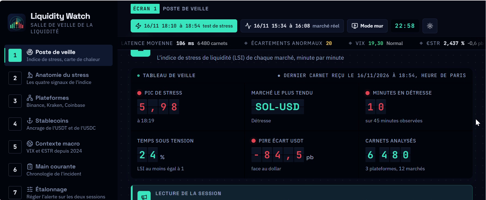
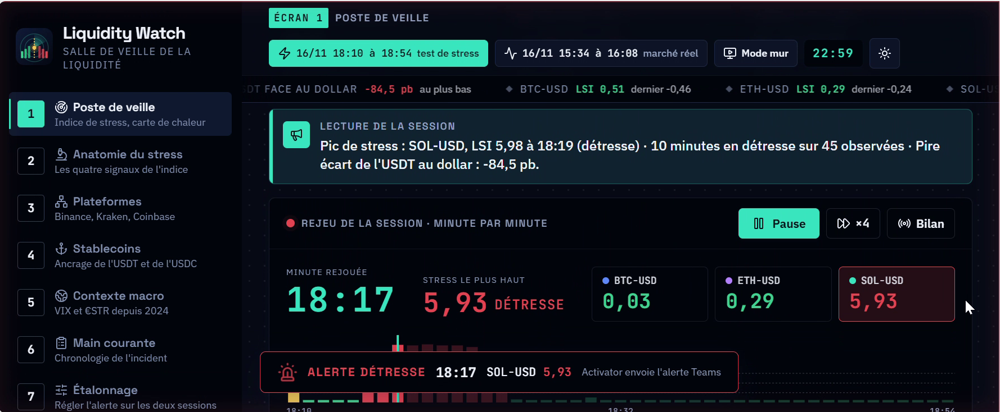

# 📱 Salle de veille Fabric Apps

[`liquiditywatch-app/`](liquiditywatch-app/) contient le code source complet de **Liquidity Watch · Salle de veille**, une application Fabric Apps (moteur Rayfin) qui lit le modèle sémantique `SM_LiquidityWatch` en DAX, en direct.

| 1 · Poste de veille | Rejeu de la crise et alarme |
|---|---|
|  |  |

Écrans, fonctions, architecture du code et déploiement : [`liquiditywatch-app/README.md`](liquiditywatch-app/README.md).

Avant de déployer, remplacez dans [`fabric.yaml`](liquiditywatch-app/fabric.yaml) les valeurs `<ID_DE_VOTRE_ESPACE_DE_TRAVAIL>` et `<ID_DU_MODELE_SEMANTIQUE>` par les identifiants de votre espace et de votre modèle (visibles dans l'adresse de leur page Fabric).
